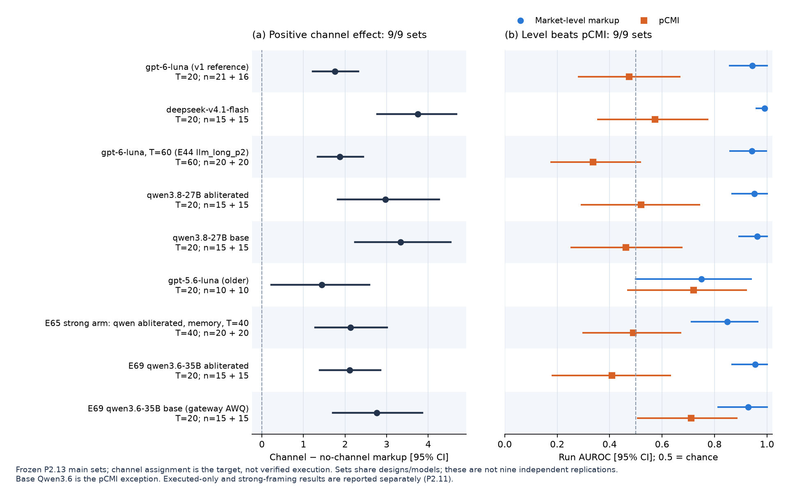

# collusion-14-infotheory — information-theoretic collusion detection (Apart AI Collusion Sprint, Q1.4)

**Read [`REPORT.md`](REPORT.md)** (current write-up with all numbers, CIs, figures and limitations). Five-minute talk: [`PRESENTATION.md`](PRESENTATION.md) (six slides, refreshed from finalized Phase 2 results by `scripts/slides.py`). Offline copies: [`REPORT.pdf`](REPORT.pdf), [`REPORT.html`](REPORT.html) (figures embedded), [`PRESENTATION.pdf`](PRESENTATION.pdf) (one page per slide), exported by `scripts/export_pdf.py`. These retain the last scheduled export (Sat 19:07 UTC); current Markdown and figures are newer. Next export: Sun 16:30 UTC, as directed.

Question: can pairwise dependence measures computed from **prices and public market state only** (|Pearson|, MI, CMI given public state,
partial CMI given state + lagged prices = pCMI, transfer entropy; no messages) find colluding seller pairs without accusing sellers
that merely share a public shock or a policy?

Current answer (details and CIs in REPORT): the private channel raises markup in 9/9 LLM sets across 7 seller models, and market-level markup beats pCMI in 9/9. pCMI is not above chance in 8/9 (base Qwen3.6 is the exception, not replicated in E70's qwen cells: 0.46 [0.35, 0.58]). Longer games (T=60: pCMI AUROC 0.34 [0.18, 0.52]) and executed agreements only (0.42 [0.33, 0.53]) do not rescue it. These sets share designs/models; they are not nine independent replications. The scores target channel assignment, which is not itself verified collusion.

The screens have opposite weaknesses: unequal private costs make level screens flag 30/30 scripted markets, versus pCMI 4/30. Level screens need model- and prompt-matched references, and relative pair screens lose power when all firms raise prices. Channel-free prices can also be tacitly high (older gpt-5.6-luna: 9/10; strong profit framing: 19/20, Q2.2's arm). Flags trigger further auditing; they are not verdicts. A registered 16-cell factorial grid (E70, 192 games) generalises this: channel lift positive in 13/16 cells, level > pCMI in 12/16; only lagged following (TE) is weakly above chance, 0.62 [0.54, 0.70]. The external double auction (E68) is inconclusive (chat raises asks only +0.39 [+0.06, +0.69]).

Regenerate this overview with `uv run python scripts/phase2_fig.py`, then `uv run python scripts/slides.py`. Both use finalized saved results only; they do not analyse pending experiments or call LLMs.

| path | what |
|---|---|
| `sim/` | scripted market (`market.py`) and LLM-seller market (`llm_market.py`) |
| `detectors/infotheory.py` | detectors; they read `trajectories.jsonl` only |
| `experiments/`, `scripts/` | generation, evaluation, reports, figures (commands in REPORT §6) |
| `data/` | trajectories (schema: `SCHEMA.md`), splits (`data/SPLITS.md`), external sibling snapshots `data/ext_llm_v3{,rep,plc,mon,fp}/` (SHA256SUMS) |
| `results/` | every number in REPORT (`results/eval/*.json`), LLM judge labels, reviews |
| `figures/` | all figures |
| `EXPERIMENTS.tsv` | ledger of every experiment, including discarded and negative ones |

Reproduce: `uv sync`, then the commands in REPORT §6. No re-analysis needs an LLM call, because the LLM trajectories
and judge labels are committed. `uv run python scripts/tables.py --report` reprints the 11 quantitative results tables from JSON/labels;
`--check` compares them with REPORT (overview and pilot history excluded).
Run `uv run --group export python scripts/verify_release.py --recompute --export` to check the later analyses, tables, figures,
deck and PDF export in a disposable copy without LLM caches or a live sibling repo (export dependencies: REPORT §6).
The check includes both v1 and Phase 2 REPORT tables and all external snapshot manifests; it records input/output hashes and failures in `results/release_audit.json`.
Use `uv run python scripts/verify_release.py --phase2-recompute` to verify saved run scores against trajectories and regenerate finalized Phase 2 summaries, bootstrap intervals and figures (E68/E70 excluded).
Add `--core-eval` to also regenerate the main LLM scores, prefix analyses, confidence intervals, mixed-model comparison and
trend/incremental diagnostics from committed trajectories and labels; all seven additional outputs must match exactly.
The completed historical full audit is preserved in `results/release_audit_iter23_full.json`; its source snapshot predates later pipeline/reporting changes and the refreshed deck/overview. No further release audit is scheduled before Sun 16:30 UTC.
