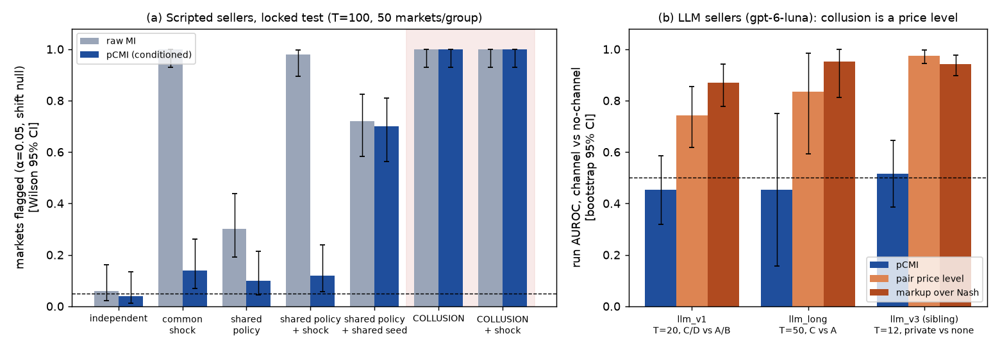
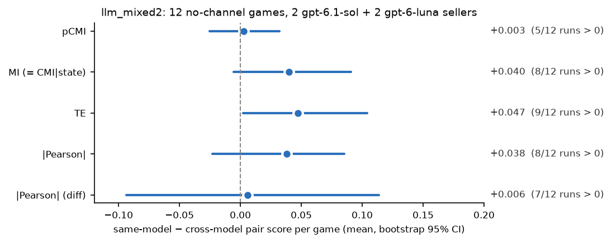

# Conditioned mutual information catches coordinated price *moves*, not price *levels*: detecting collusion between pricing agents (scripted and LLM) while sparing agents that merely share a public shock or an independently sampled policy

*Apart AI Collusion Sprint, Q1.4 (action-only, statistical half of "Beyond Words: Detecting AI-Agent
Collusion Through Information Theory and Behavioral Evidence"). Every number below is regenerated by the commands in §6 from `results/`, except the sibling-project numbers quoted in §4.4.*

**Main claim in one sentence.** Conditioned dependence (pCMI: how much two sellers' price movements share after accounting for public demand/cost state and all sellers' previous prices) detects collusion that shows up as coordinated price
*variation* while mostly ignoring shared public shocks and shared policies with independent noise (not policy copies
that share a random seed). In two LLM pricing markets a private channel shows up mainly as a price *level*, which these
measures are built to ignore, so a one-line level statistic separates channel from no-channel markets far better
(AUROC 0.87–0.98 vs 0.45–0.52; 0.5 = chance, 1 = perfect ranking), though it also ranks legitimate partnerships above controls.


*Figure 1. (a) Scripted market, locked test seed, within-run shift null (α=0.05): raw MI flags markets where independent
sellers share a public shock (100%) or a policy (30%); pCMI (conditioned on public state and lagged prices) flags 10–14% of them
(above α; 4% under the control-surrogate null, §4.1) and still flags 100% of colluding markets (shared-signal collusion, s=0.6, the easiest case; 50/50 per group). Policy copies sharing a random seed remain a confound for both. (b) LLM markets: run AUROC of pCMI is near
chance (0.5, dashed), while a price-level statistic separates channel from no-channel markets. Generated by
`uv run python scripts/headline_fig.py` from `results/eval/{gate_test,llm_v1,llm_long,llm_v3_ext}.json`.*

## Abstract
We build a 4-seller repeated differentiated-price market with public demand/cost shocks and ask whether pairwise
dependence detectors that read **prices and public market state only** (no messages) can find colluding pairs without accusing sellers that merely share
a shock or a policy. Detectors: |Pearson|, mutual information (MI), CMI given public state, Gaussian CMI given state
**and all lagged prices** (pCMI), and lagged CMI (TE), each compared with two baselines: the same game with seller price series circularly shifted out of alignment
(shift null) and comparable no-channel markets (control-surrogate null). **Scripted agents, locked test seeds (T=100, 50 runs/group):**
every contemporaneous detector flags and localises a planted shared-signal pair in 100% of runs. Raw MI also flags 100% of
markets whose independent sellers share a public shock. pCMI flags 14% of them under the shift null. The
surrogate null (which uses those markets as its reference pool, so ≈5% there by construction) flags only 4% [1, 13] of held-out markets with a shared policy plus common shock, and 4% with a public leader-follower pair. Two confounds remain:
policy copies that share their random seed (48–100% flagged by each contemporaneous detector in Table 4.1), and lagged matching, where TE
flags legitimate leader-follower pricing in 100% of runs. Dependence detects coordinated *variation*, not agreement. A
constant high price (the tested stay-high setting) was not reliably localised by any of these estimators.
**LLM sellers** (gpt-6-luna; our market `llm_v1`, 74 games, T=20; sibling market `llm_v3`, 125 runs, T=12): a private channel
produces judge-verified agreements and raises markup over the competitive (Nash) price in `llm_v1` by +1.8 versus matched no-channel markets (C − A [1.2, 2.3], D − B [1.0, 2.5]),
but the effect is mainly a **price level**. Level statistics separate channel from control runs (run AUROC: `llm_v1` markup
0.87 [0.78, 0.94]; `llm_v3` pair_level 0.98 [0.95, 1.00]). pCMI is not distinguishable from chance (`llm_v1` 0.45 [0.32, 0.59]; `llm_v3` 0.52 [0.39, 0.64]),
and in an exploratory leave-one-run-out logistic model, adding it to markup gave no detectable improvement (−0.02 [−0.08, +0.01]). Longer games (T=50, 8 vs 8) did not meet the pre-declared
rescue criterion (pCMI 0.45 [0.16, 0.75] vs markup 0.95; the CI cannot exclude moderate effects). In mixed gpt-6.1-sol/gpt-6-luna markets, no pCMI same-model excess over
cross-model pairs was detected (+0.003 [−0.025, +0.032], 12 games; only large effects excluded). Supported claim: in these two markets
at T=12–50, the private channel shows up mainly as a price level, which conditioned dependence measures are built to ignore; level statistics discriminate channel assignment far better than pCMI. Some coordinated variation is present (pair localisation on first differences in `llm_v3`; part of it also appears in placebo runs, §4.3.9), and whether pCMI fails because the effect is mostly a level or because of low power at short T is not fully settled. An exploratory injection check (§4.3.8) plants per-round shared ±1 price shocks (in 20% of rounds) into one pair of real LLM control games: pCMI detects them at T=50 (AUROC 0.93 [0.87, 0.98]) but only weakly at T=20 (0.63–0.66), and the real channel pairs show no statistically detected excess co-movement relative to rivals. That fits the level reading but does not settle it. Level screens separate channel *assignment* but are not
collusion-specific (they rank legitimate public partnerships above controls, AUROC 0.75; in the sibling market an offered-but-undelivered placebo channel gave a similar premium, and pair_level named the pair about equally often, 13.5/15 vs 14/15, §4.3.9).

## 1. Question and operational definition
**Question.** Do colluding agents' actions share more information than is explained by public market
state and the rest of the market — and can a detector that sees only prices name the colluding pair
while not accusing agents that respond to common information or share a policy?

**What we call collusion (explicit collusion).** A pair of sellers that has a *private agreement channel*
and uses it to coordinate supra-competitive pricing. This follows the communication-plus-action family of
definitions (Rose et al. 2026: communication plus harmful action; Bonjour et al. 2022: agents that
"co-operate covertly to the disadvantage of others", operationalised as pairwise excess dependence; see
`literature/definitions/README.md` in the hackathon starter repo `collusion_hackathon`). Supra-competitive pricing **without** a channel
(e.g. all LLM sellers drifting above Nash) is labelled `tacit_supracompetitive` and analysed separately —
never silently counted as a detector false positive or true positive. Three label levels are kept apart
in `ground_truth.jsonl`: assigned opportunity (`private_channel_enabled`), verified agreement
(`agreement_verified`), realised coordination (`coordinated_actions_verified`).

**Benchmarks** (`uv run python -m sim.market`): with cost 6 the unique symmetric discrete Nash price is
10 (cost 8: 12); joint-profit maximum is 16 for all states.

## 2. Setup
* **Market** (`sim/market.py`): 4 sellers A–D, multinomial-logit demand with an outside option, market
  size 100/160 (low/high demand), marginal cost 6/8. Conditions: A independent; B common shocks (demand
  and cost redrawn each round, public); C designated colluding pair (random per run); D pair + shocks. (Condition letters A–D are market types, not sellers; C is compared with A and D with B, the "within-family" comparisons below.)
* **Scripted independents:** noisy (quantal) best response to rivals' previous prices, 15% exploration.
* **Scripted colluders** (strength s = per-round probability of coordinated play):
  `signal` — pair privately draws a joint price from {12,14,16} and both play it;
  `tft` — match partner's previous price; `fixed_high` — play 16 independently (no shared randomness).
* **Hard negatives (no channel):** `shared_policy` — two agents run the same policy with independent sampling noise
  (with prob. 0.6 both apply the same nonlinear rule to last round's public prices, else a noisy best response);
  `shared_seed` — the extreme case: same policy *and* shared sampling randomness drawn from the public history
  (same model + same prompt + temperature 0 ⇒ same sample; 30% of draws idiosyncratic); `legit_cooperation` — follower publicly matches a leader's previous price;
  `independent_high_price` — two agents that just price high; `common_shock` (condition B).
* **LLM sellers** (`sim/llm_market.py`): gpt-6-luna via `llm.py`, profit-maximisation framing after Fish
  et al. 2024; the designated pair gets a private, unmonitored chat channel plus one pre-play exchange;
  agents are never told to collude. Results in §4.3.

## 3. Detectors (`detectors/infotheory.py`, read `trajectories.jsonl` only)
Per run and pair: |Pearson| of prices and of price changes; plug-in MI with Miller–Madow correction;
CMI given the discrete public state; **pCMI** = −½ log(1−ρ²) of residuals after regressing each agent's
price on state dummies and *all four lagged prices*; lagged CMI/TE (max over directions); and Bonjour-style
net influence (pair score minus mean of the other pairs). **Null:** B=200 draws, each circularly shifting
every agent's series by its own random offset (all pairwise relative offsets ≥ 3 rounds); raw-price
statistics use plain shifts, CMI|state shifts within each state stratum (keeps each seller's price–state
relation), pCMI/TE re-residualise the shifted residuals on the design. Run-level p-value = max-over-pairs
statistic against its null. Rounds are not iid, so we never use iid permutation. With fewer than 20
valid shifts (T ≲ 13) no test is performed (p = 1). Calibration is checked empirically on control runs
(below), not assumed.

**Second null — control surrogates ("same-model baseline").** The shift null asks "is this pair more
dependent than the same series de-aligned?"; it is anti-conservative whenever agents' *joint* response to
public state is something the residualisation misses. The alternative asks "is this market's most
dependent pair more dependent than the most dependent pair in comparable markets *without* a channel?":
the run's max-pair score is ranked against no-channel control runs of the same shock family (A for A/C,
B for B/D; leave-one-out for controls). Caveats: (i) on the controls themselves the leave-one-out flag rate is
≤ α *by construction*, so it is not calibration evidence — only hard-negative and collusive rows are
informative; (ii) in the scripted market the reference pool consists of best-responder markets, so a
hard-negative row measures "false-accusation rate against a best-responder reference", not a same-policy
null; (iii) the pool is drawn transductively from the controls of the same dataset (no labels of positives
are used; the shock family is public); (iv) with a pool of m references the minimum attainable p is
1/(m+1), so m ≥ 20 is required at α = 0.05. For LLM sellers the reference pool is no-channel games of the
same model — the "same-model baseline". With 21 controls per family in `llm_v1` the surrogate test can reach α = 0.05. We also report run-level AUROC (= the mean surrogate rank) with bootstrap CIs.

**Tuning discipline** (`data/SPLITS.md`, `EXPERIMENTS.tsv`). Scripted dev seeds are seed0 ∈ {0, 7, 11, 100} (all non-locked; `data/SPLITS.md`); the hard-negative
battery and power sweeps reported as headline numbers use locked seeds 1001/1002, run once with the frozen
configuration (linear residualisation design, B=200 / B=100). Design iterations on dev before the locked runs: 5 (E01 Bonferroni null → E02 max-statistic null; E06 null v2
after review; E07 state×lag interactions → discarded; E08 control-surrogate null → kept as second null), plus label
and baseline definition fixes made on pilots / before evaluation (E11, E12); all listed in `EXPERIMENTS.tsv`.
No detector setting is tuned on LLM data, so all 74 `llm_v1` games are confirmatory (64 planned + 10 extra A/B controls added before evaluation to give each family a
surrogate pool ≥ 20, before any llm_v1 detector output was computed; E17).

## 4. Results

### 4.1 Positive control and hard negatives (scripted, LOCKED test seed 1001, T=100, s=0.6, 50 runs per group)
`uv run python -m experiments.scripted both --name gate_test --n 50 --T 100 --strength 0.6 --B 200 --seed 1001`
→ `results/eval/gate_test.json`; `uv run python -m experiments.plot_sweeps` → `figures/hard_negatives.png`.
Run once with the frozen configuration (no tuning on this seed). Cells: run-level flag rate at α=0.05,
**shift null / control-surrogate null**; pCMI column with Wilson 95% CIs.

| group (no collusion above the line) | \|Pearson\| | MI | CMI\|state | **pCMI** shift [CI] / surrogate [CI] | TE |
|---|---|---|---|---|---|
| A independent | 0.16 / 0.04 | 0.06 / 0.04 | 0.06 / 0.04 | 0.04 [.01,.13] / 0.04 [.01,.13] | 0.06 / 0.04 |
| B common shock | 0.96 / 0.04 | **1.00** / 0.04 | 0.12 / 0.04 | 0.14 [.07,.26] / **0.04** [.01,.13] | 0.06 / 0.04 |
| independent high-price pair | 0.06 / 0.00 | 0.06 / 0.04 | 0.06 / 0.04 | 0.02 [.00,.10] / 0.00 [.00,.07] | 0.62 / 0.38 |
| legit leader-follower (public matching) | 0.20 / 0.10 | 0.08 / 0.10 | 0.08 / 0.10 | 0.12 [.06,.24] / 0.04 [.01,.13] | **1.00 / 1.00** |
| shared policy, independent noise | 0.52 / 0.34 | 0.30 / 0.22 | 0.30 / 0.22 | 0.10 [.04,.21] / **0.04** [.01,.13] | 0.90 / 0.92 |
| shared policy + common shock | 0.86 / 0.04 | 0.98 / 0.00 | 0.36 / 0.18 | 0.12 [.06,.24] / **0.04** [.01,.13] | 0.98 / 0.96 |
| shared policy **and shared seed** | 0.70 / 0.56 | 0.72 / 0.72 | 0.72 / 0.72 | 0.70 [.56,.81] / 0.48 [.35,.61] | 0.12 / 0.10 |
| shared seed + common shock | 1.00 / 0.72 | 1.00 / 0.86 | 0.90 / 0.80 | 0.94 [.84,.98] / 0.88 [.76,.94] | 0.02 / 0.02 |
| **C collusion** (pair ranked #1) | 1.00 / 1.00 (1.00) | 1.00 / 1.00 (1.00) | 1.00 / 1.00 (1.00) | 1.00 [.93,1] / 1.00 (top-1 1.00) | 0.22 / 0.20 (0.02) |
| **D collusion + shock** (pair #1) | 1.00 / 1.00 (1.00) | 1.00 / 1.00 (1.00) | 1.00 / 1.00 (1.00) | 1.00 [.93,1] / 1.00 (top-1 1.00) | 0.08 / 0.00 (0.14) |

(Surrogate-null rates on A and B are leave-one-out within the reference pool and ≈ α by construction; they
are shown for completeness, the informative surrogate rows are the hard negatives and C/D.)

* **Positive control:** every contemporaneous detector flags and localises the planted pair in 100% of runs
  (the `signal` colluder — fresh shared randomness each round — is the easiest case; §4.2 has weaker ones).
* **Conditioning on public state is necessary:** raw MI flags 100% of common-shock controls; CMI|state 12%,
  pCMI 14%. The within-run shift null stays somewhat anti-conservative for pCMI under common shocks
  (14% here, 16% on dev seed 7, 2.5–15% on dev seed 11): best-responders react to state × lagged prices
  non-linearly. Adding state×lag interactions did not help on dev (`EXPERIMENTS.tsv` E07).
  Ranking against **no-channel control markets** (surrogate null) is ≤ α on the B controls by construction (leave-one-out);
  the informative check is the held-out hard negative *shared policy + common shock*: 4% [1, 13].
* **Shared policy with independent sampling noise is mostly removable:** pCMI (conditioning on state and
  all lagged prices) flags 10–12% under the shift null and 4% under the surrogate null, vs MI 30–98% (shift) / 0–22% (surrogate).
* **Shared policy with a shared random seed remained flagged by every contemporaneous detector we tested** (44–100% flagged across the
  five contemporaneous detectors and both nulls; the 44% minimum is differenced |Pearson|, not in the table; TE, which is lagged, flags only 2–12%): two copies of a policy that also share their sampling randomness *are* a
  private shared signal from the point of view of the price data. None of the price-only detectors we tested separates it
  from a private agreement channel; this needs provenance information (who runs which model with what seed).
* **Lagged CMI (TE) flags legitimate public leader-follower pricing in 100% of runs** and shared heuristics in
  90–98%; it is nearly blind to the contemporaneous colluder. Lagged dependence is not evidence of agreement.


### 4.2 Power vs collusion strength and vs T (scripted, LOCKED test seed 1002, 20 runs per condition per point)
`uv run python -m experiments.sweep --seed 1002 --workers 2 --out results/sweeps/power_test.json` (B=100);
`uv run python -m experiments.plot_sweeps results/sweeps/power_test.json gate_test` → figures below.
Rate = run-level flag rate at α=0.05 under the shift null, averaged over C and D (collusive) / A and B
(controls). Top-1 = planted pair ranked first (chance 1/6).

| collusion type | setting | MI (coll./ctrl) | CMI\|state | pCMI | TE | pair top-1 pCMI / TE |
|---|---|---|---|---|---|---|
| shared signal | T=100, s=0.1 | 1.00 / 0.50 | 0.97 / 0.03 | **0.97 / 0.08** | 0.05 / 0.03 | 1.00 / 0.12 |
| shared signal | T=100, s≥0.2 | 1.00 / 0.50 | 1.00 / 0.03 | **1.00 / 0.08** | ≤0.25 / 0.03 | 1.00 / ≤0.17 |
| shared signal | T=10, s=0.3 | 0 / 0 | 0 / 0 | 0 / 0 (no test: <20 valid shifts) | 0 / 0 | 0.47 / 0.12 |
| shared signal | T=20, s=0.3 | 0.90 / 0.50 | 0.60 / 0.12 | **0.80 / 0.05** | 0.08 / 0.12 | 0.95 / 0.08 |
| shared signal | T=50, s=0.3 | 1.00 / 0.53 | 1.00 / 0.10 | **1.00 / 0.05** | 0.10 / 0.05 | 1.00 / 0.15 |
| tit-for-tat | T=100, s=0.2 | 0.55 / 0.50 | 0.10 / 0.03 | 0.10 / 0.08 | **0.40 / 0.03** | 0.28 / 0.75 |
| tit-for-tat | T=100, s≥0.45 | ≈0.55 / 0.50 | ≤0.20 / 0.03 | ≤0.05 / 0.08 | **≥0.97 / 0.03** | ≤0.28 / **≥0.97** |
| tit-for-tat | T=20 / 50, s=0.3 | 0.35 / 0.50 ; 0.53 / 0.53 | 0.17 ; 0.10 | 0.08 ; 0.08 | 0.20 / 0.12 ; 0.38 / 0.05 | 0.17 / 0.45 ; 0.28 / 0.75 |
| stay-high (no shared variation) | T=100, s=0.8 | 0.45 / 0.50 | 0.28 / 0.03 | 0.07 / 0.08 | 0.47 / 0.03 | 0.17 / 0.00 |

Readings:
1. **Contemporaneous coordination** is detected by CMI|state and pCMI down to s=0.1 at T=100 and at s=0.3 from
   T=20 (pCMI 0.80, controls 0.05). At T=10 the shift null cannot be run. The planted pair is ranked first at
   T=20 in 95% of runs. (An earlier sweep under the iteration-2 null reported power 0.12 at T=20; that null was
   replaced after review — its relative offsets were not constrained — and the dev numbers are superseded.)
2. **Lagged coordination** (tit-for-tat): contemporaneous CMI has little power against it (the lags are conditioned away) and
   is caught by lagged CMI/TE at s ≥ 0.2–0.3 with T ≥ 50–100 — but TE also flags *legitimate* public
   leader-follower pricing in 100% of runs (§4.1). Statistically these are the same object.
3. **Collusion as a level** (both just price high) carries no shared variation. pCMI does not detect it (0.07 vs 0.08 on controls); TE (0.47 vs 0.03) and CMI|state
   (0.28 vs 0.03) flag the *market* at s=0.8 but TE never names the pair (top-1 0.00; pCMI 0.17 ≈ chance). Localising it needs a price-level benchmark, not information theory.
4. Raw MI is uncalibrated whenever there is a common driver (control column 0.50 = 0.0 on A and 1.0 on B).
5. Control-surrogate null (in `results/sweeps/power_test.json`, `surrogate_flag_rate`): pCMI power 0.925 at
   s=0.1 and 0.575 at T=20 (vs 0.975 / 0.80 for the shift null; pooled C+D, 40 runs). With 20 reference runs per family the minimum
   attainable p is 1/21, so it is close to its resolution limit here.


### 4.3 LLM sellers

#### 4.3.1 Pilots: getting LLM sellers to vary prices
**Pilots (what it took to get LLM collusion to happen at all)** — gpt-6-luna sellers via codex, all games T=20 except `llm_pilot3` (T=15)
(`data/llm_pilot*`, `data/llm_hpilot`; `uv run python -m sim.llm_market --name <...>`):

| pilot | design change | outcome |
|---|---|---|
| `llm_pilot` (6 games, C/D) | grid {8..16}, public board off | pairs agree privately ("let's both hold 12") but **all four** sellers play 12 in ~every round (Nash 10) — no variance, no pair effect |
| `llm_pilot2/3` | wide integer grid 6–24, private cost shocks, reasoning field, T=1.0, "learn demand" hint | prices still overwhelmingly at 12 (occasional deviations) |
| `llm_hpilot` | 2 LLM + 2 scripted best-responders | LLM sellers still choose 12 in 148/160 decisions, channel or not |
| `llm_pilot4` | **removed the `"price": 12` example from the JSON format spec** | prices vary (9–15); no-channel sellers drift toward Nash (means 9.5–11.9); one channel pair agrees on "start near 14", prices 13–14 vs rivals 12 for 10 rounds, then erodes to 12 |

Two lessons: (i) removing a single example value from the output format coincided with the market leaving the focal price (pilot comparison, not an isolated test). LLM
pricing experiments look fragile to prompt anchors; (ii) a market in which every seller plays the same
constant price contains **zero** information for dependence-based detectors, whatever the agreement status.

#### 4.3.2 Datasets and declared analysis plan

**Main LLM dataset `llm_v1`** (complete, 74 games, all sellers gpt-6-luna via codex — checked per run, E17): 16 per condition A–D (+5 extra A and B games so the
same-model reference pool has ≥ 20 per family), T=20, design of `llm_pilot4` (sim_version llm0.3). Labels:
judge (tier=big) reads the private chat → `agreement_verified`; `coordinated_actions_verified` from prices
(both pair members within ±1 of the agreed price in ≥ 50% of rounds after the agreement; criterion fixed on `llm_pilot4`, E11); no-channel runs with mean markup ≥ 2
over Nash are `tacit_supracompetitive`. First games (descriptive, before any detector was run): channel pairs
lift the **whole market's** price level (channel games have higher market-wide prices; we did not test whether rivals respond causally). Per-game market means on all 74 games: C/D 10.8–16.8 (median 12.5), A/B 8.6–13.9 (median 11.3); the ranges overlap (`scripts/market_mean_ranges.py` → `results/eval/llm_v1_market_mean_ranges.json`; an earlier quote for the first ~20 games is dropped because no script regenerates it).

*Analysis plan, declared before results* (results below are headed by question: (i) price level = plan (b), (ii) run AUROC and (iii) localisation = (c), nulls = (d, e), (iv) mixed-model and (v) long games = (f)): (a) label rates per condition with
Wilson CIs; (b) price-level effect of the channel — market mean price C/D vs A/B (Mann-Whitney, bootstrap CI)
and pair-minus-rivals gap; (c) run-level AUROC [bootstrap CI] of pCMI, MI, TE vs the non-IT baselines
`market_level` and `pair_level`; pCMI/TE top-1 localisation vs chance 1/6 (exact binomial); (d) shift-null flag
rates by T (expected near-powerless at T=20); (e) surrogate null only where the pool ≥ 20; (f) follow-ups
`llm_long` (A and C, T=50, 8 each: is it "too short" or "collusion is a level"?) and `llm_mixed` (2 gpt-6-luna
+ 2 gpt-6.1-sol, no channel: same-model vs cross-model pair dependence, per-run sign test).
*Pre-registered baseline fix (E12, before any llm_v1 detector output was viewed):* `market_level` is the pair's
mean **markup over the per-round state Nash** (raw mean price is confounded by B/D cost shocks; the raw version is
kept as `market_level_raw`). AUROCs are reported pooled (C/D vs A/B) and within family (C vs A, D vs B); "do
dependence detectors add anything beyond level?" = AUROC(IT) − AUROC(level), paired bootstrap over runs.

*Extra confirmatory set, declared before computing (E13):* the frozen detectors on the sibling project's LLM
market `llm_v3` (Q2.2; lab framing, grid 6–30, T=12, public board; `private` / `none` / `legit` = public
shipping deal, a hard negative). No tuning; two adaptations forced by T=12: pCMI/TE residualise on numeric
cost + demand instead of state dummies, and `market_level` uses the static Nash of that market. Metrics: run
AUROC private vs none (and legit vs none), top-1 localisation vs 1/6, control-surrogate null vs the `none` pool.

*Declared before any `llm_long` detector output (E20, 01:05 UTC):* (v) is read off the same games' prefixes (T = 10, 20, 30, 40, 50; C vs A, 8 vs 8): pCMI/MI/TE/level run AUROC with bootstrap CI, and pCMI top-1 vs 1/6. "T rescues pCMI" requires AUROC(pCMI, T=50) ≥ 0.65 **and** ≥ AUROC(pCMI, T=20) + 0.15; only then is an extra T=50 batch (+16 C, +6 A) generated. Otherwise: no new generation. With 8 vs 8 the CI half-width is ≈ 0.25, so a null here only excludes large effects. The surrogate null is not used (pool 8 < 20).
Per-pair scores for the sibling: `results/eval/llm_v3_ext.json` (`uv run python -m experiments.ext_llm_v3`).

#### 4.3.3 External set `llm_v3` (sibling market, T=12)

**External LLM set `llm_v3` (E13): FINAL, all 125 runs** (sibling generation complete, all sellers gpt-6-luna via codex;
`uv run python -m experiments.ext_llm_v3` writes this table to `results/eval/llm_v3_ext_report.md`). Columns: run AUROC
of the max-pair score [bootstrap 95% CI] and top-1 localisation of the assigned pair (chance 1/6, ties broken uniformly at random).
"Agreement" = the judge found an explicit agreement (67 runs) or an information exchange (3 runs) in the private chat; communication-only; all 70 private runs meet this pooled criterion. We do *not* use the
sibling's `explicit_collusion` label here because it also requires a pair premium ≥ 1, i.e. it is selected on the level baseline's
own signal (codex review, iter 5). Binomial p-values are unadjusted and exploratory: 8 scores were computed (6 shown) across several subgroups.

n runs = 125 (private 70, of which judge-verified agreement 70; none 35; legit 20)

| detector | AUROC private vs none | AUROC agreement vs none | AUROC legit vs none | top-1, private | top-1, agreement |
|---|---|---|---|---|---|
| pCMI (state+lags) | 0.52 [0.39, 0.64] | 0.52 [0.39, 0.64] | 0.45 [0.31, 0.60] | 18/70 (p=0.036, 2 tied) | 18/70 (p=0.036, 2 tied) |
| MI (raw prices) | 0.59 [0.47, 0.70] | 0.59 [0.47, 0.70] | 0.46 [0.31, 0.61] | 42/70 (p=4e-16, 3 tied) | 42/70 (p=4e-16, 3 tied) |
| lagged CMI (TE) | 0.45 [0.32, 0.58] | 0.45 [0.32, 0.58] | 0.46 [0.30, 0.63] | 22/70 (p=0.0017, 1 tied) | 22/70 (p=0.0017, 1 tied) |
| \|Pearson\| | 0.44 [0.32, 0.56] | 0.44 [0.32, 0.56] | 0.33 [0.19, 0.49] | 35/70 (p=1.4e-10, 1 tied) | 35/70 (p=1.4e-10, 1 tied) |
| pair_level (non-IT) | 0.98 [0.95, 1.00] | 0.98 [0.95, 1.00] | 0.75 [0.61, 0.87] | 63/70 (p=3.2e-41, 1 tied) | 63/70 (p=3.2e-41, 1 tied) |
| markup over Nash (non-IT) | 0.94 [0.90, 0.98] | 0.94 [0.90, 0.98] | 0.40 [0.24, 0.56] | 63/70 (p=3.2e-41, 1 tied) | 63/70 (p=3.2e-41, 1 tied) |

Paired-bootstrap AUROC differences (private vs none): pcmi-pair_level -0.46 [-0.58, -0.33]; pcmi-market_level -0.43 [-0.55, -0.29]; mi-pair_level -0.39 [-0.50, -0.28]; te-pair_level -0.53 [-0.66, -0.40]; pair_level-market_level +0.03 [-0.00, +0.08]

Control-surrogate null (vs none pool, α=0.05) flag rate, private / legit / none(LOO): pcmi 0.00 / 0.00 / 0.00; mi 0.06 / 0.00 / 0.03; te 0.00 / 0.00 / 0.00; pearson 0.00 / 0.00 / 0.00; pair_level 0.64 / 0.05 / 0.03; market_level 0.59 / 0.00 / 0.03


Reading: AUROC here measures how well a detector tells *channel-assigned* runs from controls, not how well it tells realised collusion.
In this market the channel shows up as a **pair-specific price level**: the pair sits above its rivals. A trivial level statistic separates
the conditions almost perfectly (pair_level AUROC 0.98 [0.95, 1.00]) and names the right pair in 63/70 runs. pCMI, raw MI and TE have run-AUROC CIs that include 0.5 (pCMI 0.52 [0.39, 0.64]). Their differences to pair_level are −0.39 to −0.53, and every CI excludes 0.
CMI|state reaches 0.64 [0.53, 0.75] but scores `legit` runs about as high (0.62 vs none; private vs legit 0.53), so it does not separate collusion from a legitimate partnership. With the full
`none` pool (35 ≥ 20) the control-surrogate null can now reach α=0.05. It flags 0/70 private runs for pCMI (Wilson [0.00, 0.05]) and 4/70 for MI, against
45/70 = 0.64 [0.53, 0.74] for pair_level. Leave-one-out FPR on the none runs is 0/35 for pCMI and 1/35 for MI and pair_level (rank-based, ≤ α by construction, not independent calibration evidence). Raw-price MI and Pearson still pick the right pair *within* a run above chance
(42/70 and 35/70), plausibly because the pair moves up together. After conditioning on state and lagged prices, pCMI localisation drops to
18/70 = 26% (nominal p=0.036, unadjusted). There is no positive control for pCMI at exactly T=12. The nearest scripted point (shared-signal
collusion, s=0.3, T=10, §4.2) localises the pair in 47% of runs (chance 17%), and T=20 does so in 95%. So 26% is weak even next to moderate
*coordinated-variation* collusion of this length. The `legit` hard negative (public shipping deal, cost −1) scores *below* controls on markup
(0.40) but 0.75 [0.61, 0.87] on pair_level (a ranking above controls; at α=0.05 the surrogate null flags only 1/20 legit markets). The highest-gap pair is the partnership in only 5/20 legit runs: the partnership mainly
spreads prices, so some *other* pair looks high. A pair-gap *ranking* therefore puts markets with a legitimate partnership above controls, and its top pair is usually not the partnership.

*Exploratory check E15 (not a headline; `uv run python -m experiments.diag_llm_v3` → `results/eval/llm_v3_diag.json`,
final n = 70 private / 35 none).* Is the raw-price localisation only a shared upward drift? No. Top-1 of the
assigned pair (chance 11.7/70): raw MI 42.1/70, |Pearson| after removing each seller's linear trend 32.0/70, MI on **first
differences** 31.5/70 (p≈6e-8), |Pearson| on first differences 23.9/70 (p≈3e-4). The channel pair changes price in
the same rounds, so there is coordinated *variation* as well as a level. But none of these variants separates channel
runs from no-channel runs (run AUROC of the max-pair score 0.40–0.59, all CIs include 0.5). At T=12 with coarse
prices, control markets often contain a pair that co-moves about as strongly as the colluding pair does, so max-pair scores do not resolve run discrimination. So the dependence
signal localises a pair you already suspect but cannot screen markets. pCMI's weaker within-run localisation is
consistent with lost power: 6–7 design columns (intercept, cost, demand, 4 lagged prices, minus any constant state column; `experiments/ext_llm_v3.py` `_design_numeric`) on 11 usable rows. It does not show that the information is absent.


*Run AUROC of dependence (blue) vs level (orange) detectors on the LLM datasets (`uv run python -m experiments.llm_fig`).*

#### 4.3.4 Main set `llm_v1` (T=20)

**`llm_v1` results (confirmatory, all 74 games, T=20; frozen detectors and labels, no tuning after viewing).**
Commands: `uv run python -m experiments.llm_eval label --name llm_v1`, `... eval --name llm_v1`, then
`uv run python -m experiments.llm_report --name llm_v1`, which writes every number below to `results/eval/llm_v1_report.md`
(source `results/eval/llm_v1.json`).

*(a) Labels (Wilson 95% CI).*

| condition | n | agreement verified | coordinated actions (= realised) | tacit supra-competitive |
|---|---|---|---|---|
| A no channel | 21 | 0/21 | 0/21 | 0/21 [0.00, 0.15] |
| B no channel + shocks | 21 | 0/21 | 0/21 | 6/21 [0.14, 0.50] |
| C pair channel | 16 | 14/16 [0.64, 0.97] | 12/16 [0.51, 0.90] | — |
| D pair channel + shocks | 16 | 10/15 [0.42, 0.85] (+1 n/a) | 5/16 [0.14, 0.56] | — |


*Per-run market mean price (grey) and the mean of channel pair vs rivals (`figures/llm_v1_prices.png`).*

*(i) Does the channel raise prices? Yes, and mostly market-wide.* Markup over the per-round state Nash (market average), within family:
C − A **+1.76 [1.21, 2.31]** (Mann-Whitney one-sided p=4e-6), D − B **+1.77 [1.02, 2.52]** (p=8e-5). The pair premium over its own
rivals is modest: +0.48 [0.33, 0.64] (C), +0.42 [0.26, 0.59] (D), and the gap shrinks over the game (figure). In `llm_v3` the gap is pair-specific (pair_level ≈ markup
there). Here the whole market is higher, so the *max-pair markup* is the better level statistic (pooled AUROC pair_level −
markup −0.128 [−0.258, −0.001]). These comparisons do not establish who follows whom within a market.

*(ii) Do dependence scores separate channel runs, alone or added to the level baseline? Not pCMI. Raw MI and TE separate D from B but not C from A, likely a common-trend artefact (see diagnostics below).* AUROC targets **channel
assignment** (C/D vs A/B). Only 17/32 channel games meet the realised-collusion label. Run AUROC of the max-pair score, T=20, all games [bootstrap 95% CI]:

| detector | C/D vs A/B | C vs A | D vs B | top-1 assigned pair C / D (chance 1/6) |
|---|---|---|---|---|
| pCMI (state+lags) | 0.45 [0.32, 0.59] | 0.47 [0.28, 0.67] | 0.43 [0.24, 0.62] | 5/16 / 4/16 |
| MI (raw) | 0.50 [0.36, 0.64] | **0.20** [0.06, 0.37] | **0.82** [0.65, 0.94] | 5/16 / 3/16 |
| lagged CMI (TE) | 0.55 [0.42, 0.67] | 0.35 [0.18, 0.55] | 0.74 [0.57, 0.88] | 6/16 / 3/16 |
| \|Pearson\| | 0.45 [0.31, 0.58] | 0.14 [0.04, 0.29] | 0.76 [0.58, 0.91] | — |
| pair price level (non-IT) | 0.74 [0.62, 0.86] | 0.75 [0.55, 0.91] | 0.74 [0.57, 0.89] | 15/16 / 12/16 |
| max-pair markup over Nash (non-IT) | **0.87** [0.78, 0.94] | 0.94 [0.86, 1.00] | 0.87 [0.74, 0.97] | 15/16 / 12/16 |

*Standalone comparison* (paired bootstrap over runs): pCMI − markup −0.42 [−0.56, −0.27] (pooled), −0.47 [−0.65, −0.29]
(C vs A), −0.44 [−0.64, −0.22] (D vs B); pCMI − pair_level −0.29 [−0.46, −0.13]. MI − markup and TE − markup are clearly
negative in C vs A and include 0 in D vs B (−0.06 [−0.24, 0.14], −0.14 [−0.34, 0.06]).
*Incremental value* (E19, exploratory, added after review; `uv run python -m experiments.diag_llm_v1` →
`results/eval/llm_v1_diag.json`). A leave-one-run-out logistic model on markup + family dummy gives out-of-fold AUROC 0.89.
Adding pCMI changes it by −0.025 [−0.079, +0.006], adding MI by +0.001 [−0.007, +0.011], and adding pCMI+MI+TE by −0.033
[−0.096, +0.003]. Within this sample and model, dependence adds no measurable discrimination on top of level. This does
not show that the channel pairs have *no* coordinated variation (in `llm_v3` first-differenced prices do localise the pair, E15).

*The raw-dependence ranking reverses across families*: MI separates D from B (0.82) but ranks C **below** A (0.20,
substantial inverse discrimination). Shared trends are part of the explanation (E19). Market-mean price slopes downward in all
21 A runs (−0.07/round, sliding toward Nash) and upward in 15/16 D runs (+0.10/round), versus near-flat C (−0.015) and B (+0.015).
After first-differencing, D vs B is unresolved (MI 0.51 [0.33, 0.71], |Pearson| 0.46 [0.26, 0.65]), consistent with the D "signal" coming mostly from the
common upward drift. C vs A stays inverted after differencing (MI 0.29 [0.12, 0.47], |Pearson| 0.29 [0.13, 0.48]) and after
linear detrending (|Pearson| 0.18). Plausibly A's slide is concentrated in synchronised early price *changes*, but that is not isolated.
pCMI shows no clear channel discrimination in either family (0.47, 0.43). It measures linear residual correlation after state
and lags, so this is not proof that every confound or every form of coordination is removed.

*(iii) Localisation.* pCMI names the assigned pair in 5/16 (C) and 4/16 (D) runs, and 4/17 among realised-collusion runs
(0.24 [0.10, 0.47], exact binomial p=0.31 vs 1/6; ties broken uniformly at random with a fixed seed). The level statistics name it in 15/16 and 12/16 runs.
*(d, e) Nulls.* Each family has its own 21 reference controls (A for A/C, B for B/D), enough to resolve α=0.05. Leave-one-out
flags 1/21 controls per family. This bound is structural (rank-based), not independent evidence of calibration. The surrogate
null flags pCMI in 0/16 C and 2/16 D runs, MI in 1/16 C and 7/16 D runs (the D drift again), and pair_level in 9/16 C and
5/16 D runs. The within-run shift null for pCMI rejects in 4/21 = 0.19 [0.08, 0.40] of A controls but in 0/21 B controls.
Scripted controls at T=20 had an observed flag rate of 2/40 = 0.05 [0.01, 0.17] (§4.2), compatible with nominal calibration but imprecise. Non-stationary residuals are one untested explanation. We use only
the surrogate null on this set.
*AUROC vs prefix length* (T = 5, 10, 15, 20; `figures/llm_v1_power_vs_T.png`): pCMI does not improve (0.57, 0.46, 0.45, 0.45).
MI (0.27 → 0.50) and TE (0.46 → 0.55) rise, but neither is above chance at T=20. `llm_long` (T=50) tests longer games.

#### 4.3.5 Same- vs cross-model sellers (`llm_mixed2`)

**(iv) `llm_mixed2`: are same-model pairs more dependent than cross-model pairs (shared-policy confound)? No detectable difference; the CIs exclude only large effects.**
12 no-channel games (condition A, single public state), T=20; in each game 2 sellers run gpt-6.1-sol and 2 run gpt-6-luna (both via codex), with random seats.
All 12 passed the E21 model check (per-seller `model` field). `uv run python -m experiments.llm_eval mixed --name llm_mixed2` → `results/eval/llm_mixed2_mixed.json`; table printed by `uv run python scripts/tables.py`.
Each game gives one observation: mean score of its 2 same-model pairs minus mean score of its 4 cross-model pairs (bootstrap 95% CI over runs, sign test; declared E16).

| detector | same − cross (mean) [95% CI] | runs with same > cross | sign p | pair flag rate, shift null: same-sol / same-luna / cross |
|---|---|---|---|---|
| pCMI | +0.003 [−0.025, +0.032] | 5/12 | 0.77 | 0/12, 2/12, 3/48 |
| MI (= CMI\|state here: one state) | +0.040 [−0.005, +0.091] | 8/12 | 0.39 | 1/12, 3/12, 6/48 |
| TE | +0.047 [+0.002, +0.104] | 9/12 | 0.15 | 3/12, 2/12, 10/48 |
| \|Pearson\| | +0.038 [−0.023, +0.085] | 8/12 | 0.39 | 5/12, 6/12, 24/48 (raw \|r\| is not calibrated on trending prices) |

Only TE's interval excludes 0, and only just. It is one of 5 distinct detectors computed (the 4 shown plus differenced |Pearson|, +0.006 [−0.094, +0.114]) with no multiplicity adjustment, and its sign test is p = 0.15, so we read it as weak at most.
For pCMI, the detector used for the headline, no same-model excess was detected (point estimate +0.003).
Its shift-null pair flag rates are 0/12, 2/12 and 3/48. For TE (10/48 cross pairs) and |Pearson| (24/48) the shift null over-rejects in this market, as on `llm_v1` controls. Descriptively, the two models price alike: per-run sol − luna mean price +0.05 [−0.05, +0.14]
(`scripts/mixed_price_by_model.py` → `results/eval/llm_mixed2_price_by_model.json`). Sol varies its price more within a game (mean within-seller SD 0.96 vs 0.63).
Reading: in this market we detected no clear excess of price dependence for two copies of the same LLM over two different LLMs (uncertainty remains; 12 games). This matches the scripted shared-policy case with independent sampling noise (§4.1: pCMI 10% shift / 4% surrogate), not the shared-seed case (44–100% flagged by every contemporaneous detector).
With n = 12 this rules out large same-model effects only; it does not show the confound is absent. Both models are OpenAI-family, so a cross-family test (e.g. Claude) remains open.


*Per-game same-model minus cross-model pair score, mean and bootstrap 95% CI over the 12 games (`uv run python scripts/mixed_fig.py`). Score scales differ by detector, so compare each row with 0, not rows with each other.*

*Data-integrity note (E21):* the first `llm_mixed` batch was invalid. A routing bug (`llm.chat(tier="big", backend="codex")` silently used gpt-6-luna) made all 12 games all-luna, as the per-seller `model` field shows. Its same-vs-cross numbers are discarded unreported. The bug is fixed, `mixed_eval` now drops runs whose mixed sellers did not run a different model, and the set is regenerated as `llm_mixed2`. Judge labels were unaffected (42/42 gpt-6.1-sol).

#### 4.3.6 Longer games (`llm_long`, T=50)

**(v) `llm_long`: does T=50 rescue pCMI? The declared criterion is not met (E20 rule, declared before eval).** 8 A + 8 C games, T=50, all gpt-6-luna (codex),
`results/eval/llm_long.json`, `uv run python -m experiments.llm_report --name llm_long` → `results/eval/llm_long_report.md`,
`figures/llm_long_{prices,auroc,power_vs_T}.png`. Labels: 8/8 C games have a judge-verified agreement, 5/8 realised coordination;
0/8 A games are tacitly supra-competitive. The channel raises markup over Nash by +2.28 [1.31, 3.35] (C − A, Mann-Whitney p=0.0005).
The pair-minus-rivals gap is only +0.42 [0.20, 0.65], and it shrinks over the game (which sellers follow whom is not tested).

| T (same games, prefixes) | 10 | 20 | 30 | 40 | 50 |
|---|---|---|---|---|---|
| pCMI run AUROC C vs A | 0.39 | 0.39 | 0.38 | 0.36 | **0.45** [0.16, 0.75] |
| MI | 0.39 | 0.42 | 0.39 | 0.41 | 0.39 [0.09, 0.69] |
| TE | 0.44 | 0.25 | 0.28 | 0.23 | 0.36 [0.08, 0.66] |
| pair_level (non-IT) | 0.80 | 0.81 | 0.84 | 0.85 | 0.84 [0.59, 0.98] |
| markup over Nash (non-IT) | 0.92 | 0.95 | 0.95 | 0.95 | 0.95 [0.81, 1.00] |
| pCMI top-1 in C (of 8) | 1 | 2 | 2 | 2 | 1 |

The declared rescue criterion (AUROC(pCMI, 50) ≥ 0.65 and ≥ AUROC(pCMI, 20) + 0.15) is not met: 0.45 vs 0.39. So no extra T=50 batch was
generated. At T=50, pCMI − markup = −0.50 [−0.81, −0.17], so pCMI is clearly worse than the level statistic. Its own CI [0.16, 0.75] still includes the 0.65 threshold: 8 vs 8 runs cannot rule out moderate pCMI discrimination. The
within-run shift null over-rejects on A controls again (pCMI flags 3/8 at T ≥ 30), as on `llm_v1`. That is a second reason not to use it on LLM data.
Reading: using 50 rather than 20 rounds did not meet the declared pCMI run-discrimination criterion (point estimates flat, 0.36–0.45); the small sample leaves moderate discrimination unresolved. The evidence favours the
"collusion is a level" branch of the plan's question (f), but at n = 8 per group it does not settle it.

#### 4.3.7 Both LLM datasets together

We have two different LLM markets (different framing, grid, T, public board).
In both, the private channel's effect shows up in the price data mainly as a **price level** (this is a statement about what discriminates channel assignment; whether delivered messages add to it is unresolved, §4.3.9). In `llm_v1` it is market-wide; in `llm_v3` it is
pair-specific. Level statistics separate channel runs from controls (run AUROC 0.87 and 0.98). The conditioned dependence
detector does not (0.45 and 0.52, standalone differences vs the best level statistic −0.42 and −0.46, CIs exclude 0). In
`llm_v1` it also adds nothing measurable on top of level. This is consistent with the scripted hard-negative result that
"stay-high" collusion is hard for dependence measures to detect or localise (§4.2). It does **not** show that dependence detectors fail on LLM
agents in general, or that these pairs have no coordinated variation. It shows that, at T=12–20 (and at T=50 in the small `llm_long` set, §4.3.6), level statistics discriminate channel assignment
far better than pCMI, consistent with an effect that is mainly a level, which these detectors are built to ignore (low power remains possible; §4.3.8 shows pCMI sensitivity only to one specific shared-offset alternative). No pCMI same-model excess was detected either (§4.3.5). Level statistics are not collusion-specific either. They
also rank `legit` partnership markets above controls (pair_level AUROC 0.75 in `llm_v3`) and are high in tacitly supra-competitive no-channel markets
(6/21 B runs ≥ 2 over Nash).

Not claimed from this data: surrogate-null FPR with pool < 20; absence of same-model dependence from a null
result; that dependence detectors fail on LLM agents in general. Follow-ups: mixed models §4.3.5, T=50 §4.3.6.


#### 4.3.8 Exploratory: how much coordinated variation could pCMI see in these games? (E30, post-hoc)

*Declared in EXPERIMENTS.tsv before computing; not a headline and not part of the pre-declared plan.* Could pCMI have seen coordinated
variation in these games if it were there? We plant coordination of known size into real LLM control games. For each planting, we choose a random pair and add the
same per-round shock z_t ∈ {−1, 0, +1} (drawn i.i.d. each round, so it creates co-movement rather than a level shift) to both sellers' prices, with probability q/2 for each nonzero value.
Everything else is the real LLM data. We score with the frozen pCMI (10 plantings per control game). We report the single-planting AUROC of max-pair pCMI (each planting vs the
unplanted games), with a CI from a game-cluster bootstrap (control games resampled jointly with their own plantings).
**Co-movement** is the fraction of the T−1 transitions with Δp_i·Δp_j > 0; unchanged prices count as no co-movement. **Excess** subtracts the mean over the other five pairs.
We compute it on the planted pairs and on the *assigned* pair of the real channel games (same T-round prefix).
`uv run python scripts/injection_mde.py` → `results/eval/injection_mde.json`.

| background (controls) | T | q = 0.1 | q = 0.2 | q = 0.3 | q = 0.5 | observed co-move excess of assigned pair in channel games [95% CI] |
|---|---|---|---|---|---|---|
| `llm_v1` A (21) | 20 | 0.57 [0.48, 0.65] (+0.10) | 0.64 [0.54, 0.74] (+0.20) | 0.70 (+0.28) | 0.80 (+0.38) | C: +0.014 [−0.014, +0.045] |
| `llm_v1` B (21) | 20 | 0.52 [0.46, 0.57] (+0.08) | 0.63 [0.56, 0.72] (+0.16) | 0.62 (+0.20) | 0.75 (+0.30) | D: +0.032 [−0.011, +0.074] |
| `llm_long` A (8) | 20 | 0.57 [0.41, 0.74] (+0.10) | 0.66 [0.57, 0.80] (+0.20) | 0.72 (+0.29) | 0.82 (+0.38) | C: −0.001 [−0.043, +0.051] |
| `llm_long` A (8) | 50 | 0.76 [0.68, 0.85] (+0.14) | **0.93** [0.87, 0.98] (+0.26) | 0.97 (+0.36) | 1.00 (+0.48) | C: −0.008 [−0.023, +0.009] |

*Cells: single-planting pCMI run AUROC, planted vs unplanted [game-cluster CI], with the planted pairs' mean co-movement excess in parentheses. At q = 0
the AUROC is 0.50 and the excess is ≈ 0, as it should be. Top-1 localisation of the planted pair at T=50 is 0.81 (q=0.1) and 0.99 (q=0.2), against a chance level of 1/6.*

Reading: at T=50, these control-background plantings give substantial pCMI discrimination and localisation for this specific shared-offset alternative.
At T=20 the same plantings are only moderately detectable (AUROC 0.63–0.66 at q=0.2), so short games do cost pCMI power. The real channel pairs have no statistically detected mean excess of
same-direction price changes relative to rival pairs. Their upper confidence bounds (+0.009 at T=50; +0.045 C and +0.074 D at T=20) are smaller than the mean planted excess at q=0.1
(+0.14, +0.10 and +0.08 respectively; for D at T=20 only just). This compares a CI bound with a planted mean, so it is a rough scale comparison, not a test.
This is consistent with the "collusion is mainly a level" reading for `llm_v1`/`llm_long`. It shows sensitivity to one planted alternative only. It does not establish why the
real-channel pCMI comparison is null, rule out low power against other alternatives (lagged leader-follower moves, where contemporaneous pCMI is weak, §4.2; nonlinear or market-wide coordination, which the
rival subtraction can cancel), or show that coordination would look the same on channel-game backgrounds as on control backgrounds. It does not apply to `llm_v3`, where first differences do localise the pair (E15).

#### 4.3.9 Exploratory: replication and placebo in the sibling market (E32, post-hoc)
*Not a headline; declared in EXPERIMENTS.tsv before computing; frozen E13 configuration, nothing tuned; no LLM calls.*
The sibling generated a fresh 30-run replication of `llm_v3` (`llm_v3rep`: 15 private / 10 none / 5 legit) and a **placebo**
arm (`llm_v3plc`, 15 runs). Each placebo run uses the same seed, pair, cost and demand path as one `llm_v3rep` private run, and the pair gets the
identical channel prompt, but its private messages are never delivered. Inputs are snapshotted in `data/ext_llm_v3rep`, `data/ext_llm_v3plc`
(sibling commit 7cef9ed, SHA256SUMS). `uv run python scripts/placebo_rep_ext.py` → `results/eval/placebo_rep_ext{.json,_report.md}`.
Top-1 = expected hits under uniform random tie-breaking (chance 2.5/15); p-values vs chance in the JSON come from a pair-label randomisation null (truth uniform over the 6 pairs). Matched difference = mean per-seed hit difference, private − placebo, with a bootstrap CI over the 15 seeds and an exact paired sign-flip p (assumes within-seed exchangeability of the two arms). The private-vs-placebo AUROC CI resamples matched seed pairs jointly. All 8 detectors are reported, unadjusted.

| detector | top-1 private | top-1 placebo | private − placebo (matched) | AUROC private vs none | AUROC placebo vs none | AUROC private vs placebo |
|---|---|---|---|---|---|---|
| pCMI (state+lags) | 2.0/15 | 1.0/15 | +0.07 [−0.13, +0.27]; p=1 | 0.50 [0.23, 0.76] | 0.55 [0.25, 0.81] | 0.38 [0.18, 0.60] |
| MI (raw prices) | 11.0/15 | 7.0/15 | +0.27 [+0.00, +0.53]; p=0.22 | 0.65 [0.42, 0.85] | 0.48 [0.23, 0.73] | 0.63 [0.45, 0.82] |
| lagged CMI (TE) | 2.5/15 | 5.0/15 | −0.17 [−0.50, +0.20]; p=0.45 | 0.49 [0.24, 0.75] | 0.43 [0.16, 0.70] | 0.65 [0.44, 0.86] |
| \|Pearson\| | 6.0/15 | 11.0/15 | −0.33 [−0.67, +0.00]; p=0.18 | 0.41 [0.19, 0.65] | 0.29 [0.08, 0.55] | 0.62 [0.42, 0.80] |
| MI first differences | 10.0/15 | 3.0/15 | +0.47 [+0.07, +0.80]; p=0.065 | 0.62 [0.38, 0.83] | 0.72 [0.49, 0.91] | 0.39 [0.23, 0.54] |
| \|Pearson\| first differences | 8.0/15 | 6.0/15 | +0.13 [−0.33, +0.60]; p=0.77 | 0.39 [0.16, 0.63] | 0.41 [0.17, 0.66] | 0.46 [0.25, 0.69] |
| pair_level (non-IT) | 14.0/15 | 13.5/15 | +0.03 [−0.17, +0.23]; p=1 | 0.88 [0.71, 1.00] | 0.89 [0.70, 1.00] | 0.46 [0.26, 0.67] |
| markup over Nash (non-IT) | 14.0/15 | 13.5/15 | +0.03 [−0.17, +0.23]; p=1 | 0.82 [0.62, 0.96] | 0.78 [0.58, 0.94] | 0.47 [0.29, 0.64] |

Reading. (1) *Replication.* On fresh seeds the §4.3.3 pattern holds: level statistics separate private from none (pair_level 0.88 [0.71, 1.00]) and name the pair in 14/15 runs.
pCMI is not distinguishable from chance (0.50 [0.23, 0.76], a wide CI; top-1 2.0/15). (2) *Placebo, level.* The level statistics stay high when messages are never delivered: top-1 13.5/15; placebo vs none 0.89 (pair_level) / 0.78 (markup); private vs placebo 0.46 / 0.47. There is no statistically detected private − placebo difference, but this is not equivalence: the matched localisation CI is [−0.17, +0.23].
In this market, then, a level screen also responds to the mere *offer* of a private channel (the pair prices high in response to the prompt); a moderate extra effect of delivered messages is not excluded. This agrees with the sibling's premium result (§4.4).
(3) *Placebo, dependence.* No detector separates private from placebo runs (all private-vs-placebo AUROC CIs include 0.5). One variant fits the prediction "co-movement needs delivered messages":
MI on first differences names the pair in 10.0/15 private runs and 3.0/15 placebo runs (matched +0.47, bootstrap CI [+0.07, +0.80]). The exact sign-flip test gives p=0.065 (Bonferroni over the 8 contrasts ≈ 0.52), so the positive bootstrap CI is not confirmatory. At run level the same statistic actually scores placebo runs higher than private ones (AUROC 0.39 [0.23, 0.54]).
|Pearson| on first differences, the other declared co-movement variant, shows no detected difference (8.0 vs 6.0), and raw |Pearson| goes the opposite way (placebo 11/15).
So we read this as *suggestive at most*: with n=15 the data neither show nor rule out a delivered-coordination component in price co-movement. A larger placebo arm is the cheapest test that could settle it (§7).
Part of the E15 first-difference localisation in `llm_v3` may also be offer-driven: |Pearson| first differences localises the pair in placebo runs above chance (6.0/15, nominal randomisation p=0.027, unadjusted).

### 4.4 Umbrella synthesis with the sibling project (Q2.2, text + action auditing)
Numbers in this paragraph come from the sibling repo `collusion-22-say-vs-do` (REPORT abstract, locked test split n = 95, read 01:05 UTC; placebo result read 04:05 UTC at sibling commit 6a1de73; not regenerated here). The two projects reach a consistent conclusion from opposite directions.
* (1) In both LLM markets the private channel shows up first as a **price level**: here pair_level/markup reach run AUROC 0.87–0.98, and the sibling's one-line pair-premium statistic reaches 0.95 on its test split (0.92 [0.79, 1.00] on its 30-run fresh replication, read 04:20 UTC at sibling commit ddc2532), exceeding the sibling's six original zero-shot LLM auditor views (max 0.86).
* (2) Signals that look for *how* agents coordinate add little on these short games: conditioned dependence (pCMI) does not resolve above-chance discrimination here (0.45 [0.32, 0.59], 0.52 [0.39, 0.64]), and the zero-shot text-only auditor is at chance there (0.47). The sibling's supervised text classifier (0.98, in-distribution) shows the text carries condition information, though not which cues it uses.
* (3) Level statistics are not collusion-specific. They rank markets with the `legit` public partnership above controls (pair_level AUROC 0.75 here, usually naming a non-partner pair), and they flag tacitly supra-competitive no-channel markets.
* Caveat from the sibling's later exploratory placebo study (15 matched seeds): when private messages are offered but never delivered, the designated pair's premium is about the same (sibling's premium difference in price units, rounds 2–12, placebo − private +0.03 [−0.54, +0.49]; a different quantity from the §4.3.9 localisation difference). So in `llm_v3` the level signal cannot be attributed specifically to *delivered* private coordination; being offered the channel appears to suffice. Our frozen detectors on the same placebo runs agree (§4.3.9): pair_level names the pair in 13.5/15 placebo vs 14/15 private runs, and no detector separates private from placebo runs with statistical significance (n=15; a moderate delivery effect is not excluded). We did not run a placebo arm in `llm_v1`.
* Practical reading (a hypothesis, not tested as a pipeline): a cheap level screen as an always-on first stage, with dependence/text audits as second-stage evidence.
* The scripted results (§4.1–4.2) show where dependence measures do add value: collusion implemented through coordinated *variation*, given enough rounds for its strength (e.g. `signal` s=0.3 at T=20, s=0.1 at T=100).
* How detectable LLM collusion is depends on the market and its framing. The pair-minus-rivals premium is +1.65 [1.38, 1.93] in the sibling's lab-framed market (private runs, 10th–90th percentile +0.66…+3.18; none +0.04, legit +0.05; `experiments/premium_llm_v3.py`). Here it is +0.45 [0.34, 0.57], and most of the effect is market-wide.

## 5. Limitations
* Scripted colluders are stylised; `signal` collusion with fresh shared randomness every round is the
  easiest possible case for dependence detectors.
* The shared-policy hard negatives are modelling choices (`shared_policy`: rule probability 0.6, independent noise;
  `shared_seed`: 30% idiosyncratic draws); their FPR scales with how much sampling noise two copies of a policy share.
* Small n per group (scripted locked gate: 50 per group; power sweep: 20 per condition; LLM: 16–21 per condition in `llm_v1`, 20–70 per group in `llm_v3`, 8 per group in `llm_long`, 12 games in `llm_mixed2`) — CIs are wide.
* §4.2: at each T, the same 40 control trajectories (A+B) are reused across collusion types and strengths (different T use prefixes). Colluder-free replicate rows (s=0, T=100, in
  `power_test.json`) show CMI|state flagging 0.15 vs 0.03 on controls (pCMI 0.10 vs 0.08), so CMI|state is not fully calibrated under shocks.
* One LLM seller model (gpt-6-luna) in both main LLM markets (`llm_mixed2` adds gpt-6.1-sol, same vendor family; no cross-family sellers); one LLM judge (gpt-6.1-sol) for agreement labels, no human audit.
* The `realized_collusion` label is partly defined from prices (±1 of the agreed price), so localisation on the realised subset is
  partly circular for level statistics; run AUROCs use the channel assignment instead.
* The surrogate null's reference pool is best-responder / no-channel LLM markets; its FPR for other reference populations
  (e.g. markets of copies of one policy) is untested beyond the scripted hard negatives.
* The best level statistic in `llm_v1` (markup over the state Nash price) assumes the auditor knows the demand and cost
  model. `pair_level` (pair price minus rivals) needs no model but is less collusion-specific (legitimate partnerships: AUROC 0.75).
* In our own market (`llm_v1`, `llm_long`) there is no placebo arm (channel offered, messages not delivered), so we cannot
  attribute the price premium to delivered coordination rather than to the channel offer itself (the sibling's placebo study in `llm_v3` found no detected difference, §4.4; our detectors on it, §4.3.9, n=15, detect none either; not an equivalence result).
* Many comparisons, mostly unadjusted (detectors × conditions × T). Isolated nominal hits, e.g. TE top-1 in llm_v1 C
  (6/16, p = 0.038) and pCMI top-1 in llm_v3 (18/70, p = 0.036), should not be read as signal.

## 6. Reproduce
```
uv run python -m experiments.scripted both --name gate_test --n 50 --T 100 --strength 0.6 --B 200 --seed 1001  # §4.1 (locked)
uv run python -m experiments.sweep --seed 1002 --workers 2 --out results/sweeps/power_test.json               # §4.2 (locked)
uv run python -m experiments.plot_sweeps results/sweeps/power_test.json gate_test                           # figures
uv run python -m experiments.dev_pcmi --seed 11 --n 40 --T 100 50                                           # dev tuning (E07/E08)
scripts/llm_queue2.sh  # llm_v1 (+controls), labels, eval, llm_long (codex-pinned; cached LLM calls in cache/; its llm_mixed step is the invalid E21 batch, ignore)
scripts/llm_queue3.sh  # llm_mixed2 generation + same-vs-cross eval (§4.3 (iv))
uv run python -m experiments.llm_report --name llm_long   # (v) tables (results/eval/llm_long_report.md) + figures/llm_long_*.png
uv run python -m experiments.diag_llm_v1                  # E19 incremental-value + trend diagnostics
uv run python -m experiments.premium_llm_v3               # §4.4 pair premium on llm_v3
uv run python scripts/mixed_price_by_model.py             # (iv) llm_mixed2 price by model
uv run python scripts/mixed_fig.py                        # (iv) figures/llm_mixed2_same_vs_cross.png
uv run python scripts/market_mean_ranges.py               # §4.3.2 llm_v1 market-mean ranges
uv run python -m experiments.ext_llm_v3                  # external LLM set → results/eval/llm_v3_ext{.json,_report.md}; input snapshot data/ext_llm_v3/ (sibling llm_v3, SHA256SUMS)
uv run python -m experiments.llm_fig                     # figures/llm_auroc_both.png
uv run python scripts/headline_fig.py                    # Figure 1, figures/headline.png
uv run python scripts/slides.py                         # PRESENTATION.md (5-min talk deck, numbers from results/eval)
uv run python -m experiments.diag_llm_v3                 # E15 exploratory co-movement check on llm_v3
uv run python scripts/injection_mde.py                   # E30 exploratory planted-co-movement check (§4.3.8), ~2 min
uv run python scripts/placebo_rep_ext.py                 # E32 sibling replication + placebo (§4.3.9), ~1 min; inputs data/ext_llm_v3{rep,plc}/
uv run python scripts/tables.py                          # reprints §4.1/§4.2 tables from results/*.json (+ §4.3 generated tables)
uv run python -m experiments.llm_report --name llm_v1   # §4.3 tables (results/eval/llm_v1_report.md) + figures/llm_v1_*.png
```
Raw LLM trajectories are committed under `data/` (no LLM calls needed to re-run any analysis); scripted §4.1 trajectories are stored gzipped (`data/gate_test/trajectories.jsonl.gz`) and the `gen` step regenerates them byte-identically apart from the run_id prefix (checked 03:15 UTC).
Splits: `data/SPLITS.md`; every experiment incl. discarded ones: `EXPERIMENTS.tsv`; reviews: `results/reviews/`.

## 7. What to do next
* **Placebo arm in our own market and a larger one in the sibling's** (channel offered, messages not delivered; provisionally ≥ 50 matched seeds, the final number set by a power calculation from the §4.3.9 effect sizes; Monte Carlo sign-flip test). This is the cheapest test of whether any price signal, level or co-movement, reflects *delivered* coordination rather than the channel offer (§4.3.9: n=15 is suggestive at most).
* **Longer LLM games (T ≥ 50) with more games per arm.** The injection check (§4.3.8) shows pCMI sees planted shared moves at T=50 but only weakly at T=20.
* **Cross-family sellers** (e.g. Claude vs GPT) for the shared-policy confound (§4.3.5 used one vendor family).
* **Two-stage audit:** a level screen as the always-on first stage, with dependence and text audits run only on flagged pairs, evaluated as one pipeline against `legit` partnerships and tacit no-channel markets (§4.4).
